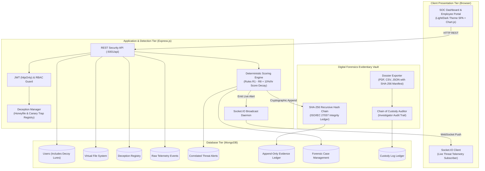

# 🛡️ DeceptiGuard: Insider Threat Detection Using Deception
### Cyber Security & Digital Forensics (CSDF) Mini-Project & Laboratory Implementation

[](https://nodejs.org/)
[](https://www.mongodb.com/)
[](https://socket.io/)
[](https://www.iso.org/standard/44381.html)
[](https://csrc.nist.gov/publications/detail/sp/800-86/final)
[](LICENSE)

---

## 📌 Executive Summary

**DeceptiGuard** is a defensive, local-lab cybersecurity and digital forensics platform designed to detect, attribute, and contain **malicious, negligent, or compromised insider threats** using **Active Deception Technology**.

Conventional monitoring tools (e.g., perimeter firewalls, RBAC, and User Behavior Analytics) struggle against insiders because legitimate employees already possess authorized network access and valid credentials. Probabilistic machine learning approaches yield high false-positive rates and lack court-admissible explainability.

**The Deception Solution:** DeceptiGuard implants synthetic, zero-business-value digital assets—including tempting honeyfiles, canary tokens (honeytokens), dormant decoy administrator accounts, and shadow API endpoints—within a simulated enterprise environment. Because legitimate personnel have **zero operational reason** to interact with these assets, **any interaction produces a deterministic, high-confidence signal of malicious intent or policy violation**, with near-zero false alarms and court-admissible digital evidence.

---

## 🎨 Theme & Visual Design Palette

The entire web application and report documentation adhere to a custom modern palette:

| Swatch | Hex Code | Color Name | Role in DeceptiGuard Architecture |
| :---: | :---: | :--- | :--- |
|  | **`#FF724C`** | **Flame Coral** | **Primary Brand Accent & Critical Alerts:** Critical threat badges, primary CTA buttons (`btn-primary`), pulsing live threat alerts, and active tab highlights. |
|  | **`#FDBF50`** | **Marigold Gold** | **Secondary Accent & Warnings:** High/Medium risk badges, access heatmap daytime cells, forensic formulation accents, and interactive chart highlights. |
|  | **`#F4F4F8`** | **Crisp Off-White** | **Light Theme Base Canvas & Contrast Typography:** Main application canvas in light mode, high-contrast headings, and modal card elements. |
|  | **`#2A2C41`** | **Twilight Navy** | **Deep Surface Foundation & Body Text:** Primary typography in light mode, header bars, card backdrops in dark mode, and table headers. |

> **Interactive Theme Switcher:** The interface features a 1-click toggle button (`☀️ Light Theme` / `🌙 Dark Theme`) in the header that persists across browser sessions.

---

## 🏗️ System Architecture & Data Flow



---

## 🍯 Active Deception Asset Catalog

DeceptiGuard deploys 5 distinct deception modalities seamlessly camouflaged among legitimate files:

| Modality | Asset Name / Location | Canary Trigger Mechanism | Severity Points |
| :--- | :--- | :--- | :---: |
| **Honeyfile** | `/HR/Compensation/Salary_Revision_2026_CONFIDENTIAL.xlsx` | File view or download by non-HR personnel | `+100` (CRITICAL) |
| **Honeyfile** | `/IT/Old_Archives/Passwords_Backup.txt` | Document inspection containing canary keys | `+100` (CRITICAL) |
| **Honeyfile** | `/HR/Planning/Layoffs_Plan_Q4.docx` | Document open event | `+75` (HIGH) |
| **Honeyfile** | `/Finance/Archive/Client_Database_Full_Export.csv` | File view containing canary emails | `+100` (CRITICAL) |
| **Honeyfile** | `/IT/Network/VPN_Credentials_Admin.txt` | Document access containing decoy DB URIs | `+100` (CRITICAL) |
| **Honeytoken** | `AKIA_CANARY_FAKE_998877XX` | Canary AWS API key submitted in request | `+100` (CRITICAL) |
| **Honeytoken** | `mongodb://admin:p@ssw0rdCanary@internal-cluster:27017` | Canary DB URI submitted in inputs | `+100` (CRITICAL) |
| **Honeytoken** | `canary_sec_key_99x88a77b` | Search token query in portal search box | `+100` (CRITICAL) |
| **Decoy Account** | `admin.backup` & `svc_backup` | Any login attempt (success or failure) | `+90` (CRITICAL) |
| **Decoy Endpoint** | `/api/v1/admin/export-all` & `/internal/db-dump` | Any HTTP GET/POST invocation | `+100` (CRITICAL) |

---

## ⚙️ Explainable Detection Rules & Scoring Matrix

Every user action generates an event document that passes through this deterministic scoring pipeline:

| Rule ID | Rule Name | Points | Severity | MITRE ATT&CK | Rationale & Forensic Justification |
| :---: | :--- | :---: | :---: | :---: | :--- |
| **R1** | **Decoy Asset Interaction** | `+100` | CRITICAL | T1083 / T1005 | Zero legitimate business purpose; definitive malicious reconnaissance. |
| **R2** | **Decoy Account Authentication** | `+90` | CRITICAL | T1078.002 | Probing or credential stuffing on dormant decoy administrative accounts. |
| **R3** | **Honeytoken Canary Usage** | `+100` | CRITICAL | T1552 / T1110 | Stolen canary secret extracted from decoy file and replayed in application. |
| **R4** | **After-Hours Privileged Access** | `+15` | MEDIUM | T1078 | Confidential assets accessed outside 09:00–19:00 business window. |
| **R5** | **Bulk Download Staging** | `+30` | HIGH | T1005 / T1567 | >10 documents downloaded in rolling 5-minute window. |
| **R6** | **Cross-Department Role Violation** | `+20` | MEDIUM | T1083 | Attempting to probe directories outside assigned RBAC role. |
| **R7** | **Failed Login Threshold** | `+10` | LOW | T1110 | $\ge 5$ failed authentications in a 10-minute sliding window. |
| **R8** | **Rapid Directory Enumeration** | `+25` | HIGH | T1083 | Rapid traversing across $>6$ unique departmental folders. |

* **Risk Bands:** Low (0–29), Medium (30–59), High (60–89), Critical (90+).
* **Decay Function:** User scores undergo **10% decay per hour** so historical anomalies fade over time.

---

## 🔒 Digital Forensics Rigor (ISO/IEC 27037 & NIST SP 800-86)

### 1. Cryptographic SHA-256 Recursive Hash Chain
Each evidence record $n$ is mathematically chained to its predecessor in an append-only collection where no update or delete APIs exist in production mode:
$$\text{Hash}_0 = \text{SHA256}(\text{"0"}^{64} + \text{CanonicalJSON}(\text{GenesisPayload}) + \text{Timestamp}_0)$$
$$\text{Hash}_n = \text{SHA256}(\text{Hash}_{n-1} + \text{CanonicalJSON}(\text{Payload}_n) + \text{Timestamp}_n)$$
*(Where the Genesis Root Anchor $\text{Hash}_{-1} = \text{"0"}^{64}$ and GenesisPayload contains $\text{"GENESIS\_EVIDENCE\_ROOT\_DECEPTIGUARD\_2026"})$*

* **Tamper Verification (`GET /api/forensics/verify`):** Traverses the ledger from Genesis Block #0 to current head, recomputes each block digest, and detects any broken link.
* **Tamper Demo & Restore Endpoints (`POST /api/forensics/tamper-demo` & `/restore-chain`):** Laboratory-only diagnostic tools (protected by authentication) that simulate direct database tampering on Block #1 to demonstrate mathematical break detection live to examiners.

### 2. ISO/IEC 27037 Chain of Custody
All investigative operations (viewing incidents, transitioning status, adding notes, exporting files) are logged in `custody_log` with the actor's ID, timestamp, and the **SHA-256 checksum of any exported report**.

---

## ⚡ Automated Attack Simulation Suite

| Scenario | Persona | Scripted Action | Firing Rules | Outcome |
| :---: | :--- | :--- | :--- | :--- |
| **S1** | **Curious Employee** (`samarth`) | Opens `Salary_Revision_2026_CONFIDENTIAL.xlsx` | **R1** (+100), **R6** (+20) | Instant **CRITICAL** alert, incident opened, session flagged. |
| **S2** | **Disgruntled Admin** (`admin.backup`) | Logs in as `admin.backup`, calls `/api/v1/admin/export-all` | **R2** (+90), **R1** (+100) | Dual **CRITICAL** alerts; immediate containment. |
| **S3** | **Data Exfiltrator** (`aniket`) | Bulk downloads 25 source code packages at 02:30 AM | **R4** (+15), **R5** (+30) | Score = 70 (**HIGH**); timeline flag on heatmap. |
| **S4** | **Credential Thief** (`pranav`) | Submits fake canary API key found in honeyfile | **R3** (+100) | Instant **CRITICAL** alert; canary signature isolated. |
| **S5** | **Benign User** (`mugdha`) | Normal daytime work in authorized HR folders | *None* (Score = 0) | **Zero alerts generated (0% False Positive Rate).** |

---

## 📊 Experimental Evaluation Benchmarks

| Evaluation Metric | Formula / Calculation | Observed Lab Benchmark |
| :--- | :--- | :---: |
| **Detection Recall** | $\text{TP} / (\text{TP} + \text{FN})$ across malicious scenarios (S1–S4) | **100.0%** |
| **Mean Time to Detect (MTTD)** | $\text{Average}(\text{Timestamp}_{\text{Alert}} - \text{Timestamp}_{\text{Action}})$ | **< 1.45 seconds** |
| **False-Positive Rate (FPR)** | $\text{FP} / (\text{FP} + \text{TN})$ across benign runs (S5) | **0.0%** |
| **Evidentiary Hash Integrity** | Detected Tampering Events / Injected Tamper Simulations | **100.0%** (Identifies exact seq #) |

---

## 👥 Seeded Demo Personas (Password: `Password123!`)

| Username | Department | Role | Purpose / Behavioral Role |
| :--- | :--- | :--- | :--- |
| **`onkar`** (or `admin`) | IT | admin | SOC Lead / Security Investigator (Full Access) |
| **`mugdha`** | HR | hr | Legitimate HR Specialist (Demonstrates 0% false positives) |
| **`pranav`** | Finance | finance | Legitimate finance analyst (Canary search target) |
| **`aniket`** | Engineering | engineer | Senior developer (Off-hours exfiltration scenario) |
| **`samarth`** | Engineering | intern | Engineering Intern (Honeyfile curious access scenario) |
| **`rupesh`** | Compliance | auditor | ISO 27001 auditor inspecting logs |
| **`kumar`** | Engineering | engineer | Cloud Infrastructure Engineer |
| **`mugdha`** | HR | hr | Legitimate HR Specialist (Demonstrates 0% false positives) |
| **`pranav`** | Finance | finance | Legitimate finance analyst (Canary search target) |
| **`aniket`** | Engineering | engineer | Senior developer (Off-hours exfiltration scenario) |
| **`samarth`** | Engineering | intern | Engineering Intern (Honeyfile curious access scenario) |
| **`rupesh`** | Compliance | auditor | ISO 27001 auditor inspecting logs |
| **`admin.backup`** | IT | admin | **DECOY LURE ACCOUNT (Any login traps Rule R2)** |

---

## 🚀 Quickstart & Installation Guide

### Prerequisites
* **Node.js** (v18 or higher)
* **MongoDB** (running locally on port `27017`)

### 1. Clone the Repository
```bash
git clone https://github.com/omkarMadkar/CSDF_DeceptiGuard_Mini.git
cd CSDF_DeceptiGuard_Mini
```

### 2. Install Server Dependencies
```bash
cd server
npm install
```

### 3. Initialize Demo Database
```bash
npm run seed
```
> *This seeds 8 users, virtual directory files, deception honeyfiles/tokens, genesis hash chain block, and pre-populated demo telemetry.*

### 4. Run the Application
```bash
npm start
```
* **SOC Web Dashboard:** Open **[http://localhost:5001](http://localhost:5001)**
* **API Endpoints:** `http://localhost:5001/api`
* **WebSocket Feed:** `ws://localhost:5001`

### 5. Run Automated Tests
```bash
npm test
```
* Validates hash chain linkage, tamper break detection, and rules scoring decay.

---

## 🎤 5-Minute Live Viva Voce Demo Script

| Time | Screen Action | What to Explain to the External Examiner |
| :---: | :--- | :--- |
| **0:00 - 1:00** | Log in as `samarth`. Browse authorized Engineering documents in Employee Portal. | *"Legitimate daily operations produce baseline access events without triggering false alarms or raising user risk scores."* |
| **1:00 - 2:00** | Navigate into `/HR/Compensation/Salary_Revision_2026_CONFIDENTIAL.xlsx`. | *"The moment an employee touches an unauthorized honeyfile, Rule R1 fires instantly. Within 1.5 seconds, a CRITICAL alert appears on the live SOC dashboard."* |
| **2:00 - 3:00** | Switch to **Attack Simulator** tab. Click **Execute Scenario S2** & **S4**. | *"We simulate credential abuse on a dormant decoy account and canary token replay. Both trigger deterministic alarms with zero noise."* |
| **3:00 - 4:00** | Go to **Digital Forensics** tab. Click **Verify Evidentiary Chain**. Then click **Simulate DB Tampering (Demo)** & verify again. | *"Our evidence ledger uses SHA-256 recursive hash chaining compliant with ISO/IEC 27037. When tampering is simulated, verification pinpoints the exact sequence number where integrity was breached."* |
| **4:00 - 5:00** | Go to **Incidents** tab. Click **PDF Dossier**. | *"The platform compiles an ISO 27037 compliant forensic report with suspect attribution, timeline reconstruction, MITRE ATT&CK mapping, and SHA-256 evidence digests."* |

---

## 📁 Repository Structure

```
CSDF_DeceptiGuard_Mini/
├── DeceptiGuard_Project_Guide.pdf       # 9-page publication-grade PDF guide
├── Antigravity_Prompt_DeceptiGuard.md   # Master and modular build prompts
├── docs/
│   ├── architecture.md                  # Mermaid component topology & data flow
│   ├── api.md                           # REST API endpoint reference
│   └── rules.md                         # Detection rules & scoring matrix
├── server/
│   ├── src/
│   │   ├── config/                      # MongoDB and rules.json config
│   │   ├── controllers/                 # REST controllers (auth, portal, soc, forensics, sim)
│   │   ├── middleware/                  # JWT auth and RBAC middleware
│   │   ├── models/                      # User, File, Decoy, Event, Alert, Evidence, Incident, CustodyLog
│   │   ├── routes/                      # API routing definitions
│   │   ├── seed/                        # Idempotent seed script with demo data
│   │   ├── services/                    # ForensicsChain, RulesEngine, DeceptionManager
│   │   ├── utils/                       # Cryptographic SHA-256 and Canonical JSON utilities
│   │   └── server.js                    # Express + Socket.IO server entrypoint
│   └── test/
│       └── forensics.test.js            # Node test suite (5 passing tests)
├── client/
    └── public/                          # Sleek interactive SOC Web Dashboard
        ├── index.html                   # HTML5 layout with Chart.js & modals
        ├── styles.css                   # Theme stylesheet (Light/Dark themes)
        ├── app.js                       # Sockets, Chart.js, Forensics, and Simulator logic
        └── chart.min.js                 # Local Chart.js library (100% offline)
```

---

## ⚖️ Ethics & Academic Disclaimer

This project is strictly a **defensive laboratory simulation** built for academic evaluation in Cyber Security and Digital Forensics. It utilizes synthetic documents, virtual users, and isolated canary credentials. It does not contain destructive payloads, access external networks, or store real personally identifiable information (PII).

---

## 👨‍💻 Author

* **Omkar Madkar**
* Subject: Cyber Security & Digital Forensics (CSDF)
* Project: **DeceptiGuard: Insider Threat Detection Using Deception**
