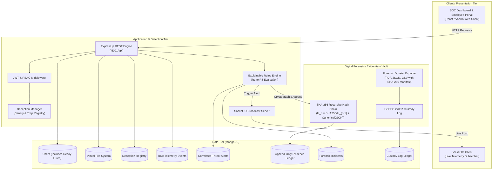

# DeceptiGuard: Architecture Specification
## Component Architecture & Data Flow

### Forensic Evidentiary Ingestion Pipeline
1. **User Action:** Employee views or downloads a document or makes an API request.
2. **Context Enrichment:** Action tagged with timestamp (UTC), IP, user-agent, session ID, and role.
3. **Deception Check:** Evaluated against `Decoy` collection.
4. **Scoring Engine:** Fired rules add weighted risk points; decay is applied dynamically.
5. **Cryptographic Chaining:** Each record incorporates the SHA-256 digest of the predecessor record.
6. **Real-time SOC Broadcast:** Socket.IO emits the threat event to active analysts.
